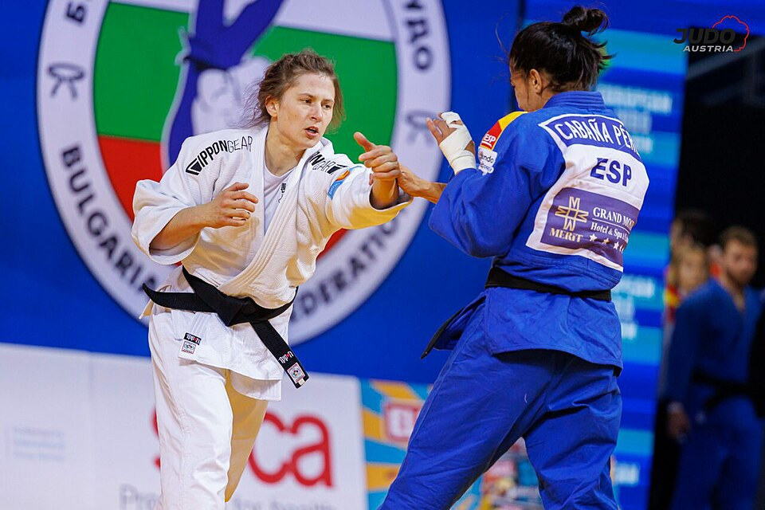
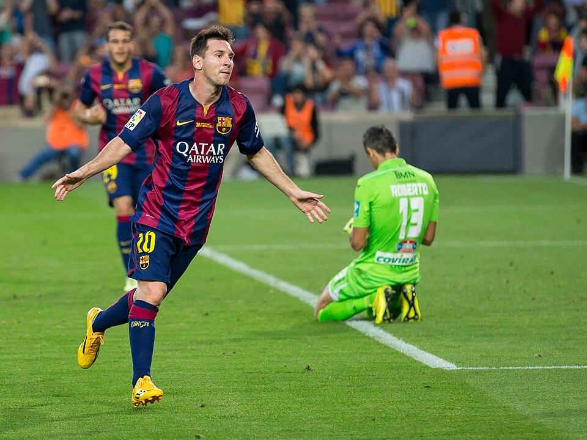
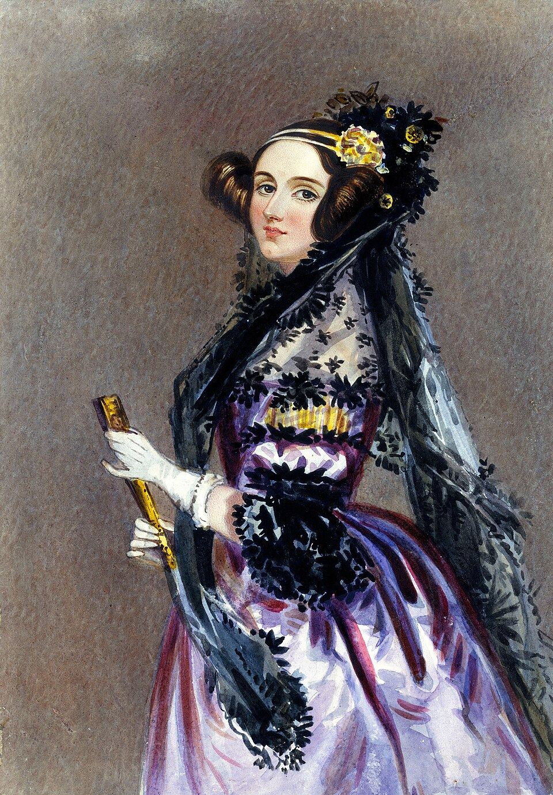

 [← Volver al inicio](README.md)
# Temas del curso
### 16/09 Mis aficiones
Llevo practicando judo desde los seis años, es decir, llevo once años
en este deporte. Empecé en judo porque iba mi hermana y al final me acabo
gustando. Hace unos cuatro años me cambie de club y empecé a practicar 
nuevas disciplinas como sambo, grappling y lucha.
Y hace un año empecé en kickcboxing que es una de mis disciplinas
favoritas. Entreno de lunes a viernes unas dos horas y media y los
findes suelo tener competiciones y entrenos especiales.
Además también me gusta viajar con mis compañeros y amigos.

Aquí dejo una URL de una página de Github que habla sobre judo:

[enlace](https://github.com/pablop-dev05/web_judo)

### 28/09 Premios princesa: Leo Messi
El premiado que he elegido es Leo Messi, lo he escogido porque me gusta el deporte y me parece una persona interesante además por como a pesar de su problema de crecimiento siguió esforzándose y siendo constante para llegar
hasta donde esta ahora.

[enlace](https://www.fpa.es/es/premios-princesa-de-asturias/premiados/2026-leo-messi/)

Leo Messi ha sido premiado debido a su gran talento en el futbol y su trayectoria deportiva. Y también por ser una persona solidaria que es colaboradora de la fundación UNICEF y por su fundación Leo Messi que busca ayudar
a la educación y a la salud de los niños.
Messi es uno de los futbolistas más destacados de la historia, es el jugador con más partidos jugados y títulos del FC Barcelona y de la selección Argentina. Ha conseguido un montón de premios como mejor futbolista y también como goleador habiendo marcado en un año un total de 92 goles. Además de sus premios como futbolista también destaca por su gran rendimiento y constancia tanto dentro como fuera del campo y por ser una persona tan solidaria que busca ayudar a otras personas sobre todo a niños a nivel de educación y salud.

En la imagen que hay a continuación podemos ver a Messi celebrando un gol. 

## 13/10 · Ada Lovelace
Ada Lovelace nació en Londres en 1815. Era hija de Annabella Milbanke y el poeta Lord Byron. Se separaron cuando ellas apenas tenía un mes. Su madre se obsesionó con que recibiese clases de matemáticas y ciencia para así alejarla lo máximo posible de su herencia poética. Siguió estudiando matemáticas durante gran parte de su vida hasta que tuvo a su tercer hijo y empezó a colaborar con Babbage en la máquina analítica añadiendo anotaciones al texto original e incluyó un algoritmo detallado para calcular los números de Bernoulli. Ada se convirtió en la primera programadora de la historia, según se dice en su biografía publicada por el Museo Nacional de Ciencias Naturales.
Se celebra su día para reconocer su gran logro en la historia de la ciencia y la tecnología. Se celebra el segundo martes de octubre.

[Ada Lovelace en mncn](https://www.mncn.csic.es/es/visita-el-mncn/biografia-de-ada-lovelace)

{: width="300"}
 Imagen: Alfred Edward Chalon, [Wikimedia Commons](https://commons.wikimedia.org/w/index.php?search=ada+lovelace&title=Special%3AMediaSearch&type=image)

